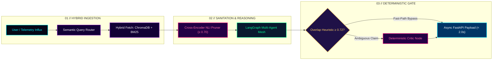

<!-- ======================================================================= -->
<!--              SUPROVO MALLICK // DYNO // NEURAL CORE v8.0 ULTRA          -->
<!--        MAX-PRO CYBER-ARCHITECTURAL GITHUB PROFILE & TELEMETRY HUD       -->
<!-- ======================================================================= -->

<div align="center">

  <!-- 1. ULTRA-WIDE DYNAMIC NEON HERO BANNER -->
  

  <!-- 2. LIVE TERMINAL TELEMETRY STREAM -->
  <a href="https://dyno-suprovo-github-io.vercel.app/">
    
  </a>

  <!-- 3. TACTICAL HUD STATUS PILLS -->
  <p align="center">
    <a href="#-01--neural_dossier-identity_matrix"></a>
    <a href="#-02--architectural_core-evidence_first_ai"></a>
    <a href="#-04--open_source_ops-upstream_engineering"></a>
    <a href="#-07--algorithmic_core-problem_solving"></a>
    
  </p>

  <!-- 4. QUICK-JUMP COMMAND DOCK -->
  <p align="center">
    <a href="#-01--neural_dossier-identity_matrix"><code>[01 // DOSSIER]</code></a> •
    <a href="#-02--architectural_core-evidence_first_ai"><code>[02 // ARCHITECTURE]</code></a> •
    <a href="#-03--flagship_systems-production_nodes"><code>[03 // SYSTEMS]</code></a> •
    <a href="#-04--open_source_ops-upstream_engineering"><code>[04 // OSS & BADGES]</code></a> •
    <a href="#-05--tactical_armory-full_spectrum_stack"><code>[05 // ARMORY]</code></a> •
    <a href="#-06--industry_log-experience_&_research"><code>[06 // RESEARCH]</code></a> •
    <a href="#-07--algorithmic_core-problem_solving"><code>[07 // DSA CORE]</code></a> •
    <a href="#-08--credentials_vault-certifications"><code>[08 // VAULT]</code></a> •
    <a href="#-09--telemetry_stream-repo_metrics"><code>[09 // TELEMETRY]</code></a>
  </p>

  <!-- LASER DIVIDER -->
  

</div>

<br/>

<!-- ======================================================================= -->
<!--                     01 // NEURAL DOSSIER & TELEMETRY                    -->
<!-- ======================================================================= -->

##  `01 // NEURAL_DOSSIER [IDENTITY_MATRIX]`

<table width="100%">
  <tr>
    <td width="58%" valign="top">

```yaml
# ── OPERATOR SPECIFICATION ──────────────────────────────
OPERATOR:       Suprovo Mallick
CALLSIGN:       DYNO
DESIGNATION:    Generative AI & ML Systems Architect
ACADEMICS:      B.Tech in Computer Science @ KIIT (2023 – 2027)
ACCREDITATION:  BS in Data Science (Foundation) @ IIT Madras
COORDINATES:    West Bengal, India [22.5726° N, 88.3639° E]

# ── ENGINEERING MANIFESTO ───────────────────────────────
DIRECTIVE: >
  "Notebook prototypes are child's play. I engineer verifiable,
  evidence-grounded, low-latency AI pipelines and multi-agent
  meshes architected to withstand heavy production concurrency."
```

#### ⚡ `SUBSYSTEM CAPABILITY GAUGES`

| CAPABILITY VECTOR | TELEMETRY LOAD | CORE MECHANISM |
| :--- | :---: | :--- |
| **Adaptive RAG & Dynamic Pruning** | `████████████████` **100%** | Cross-Encoder NLI Filtering (`>= 0.70`) |
| **Open Source Runtime Patching** | `████████████████` **98%** | ComfyUI • LlamaIndex • Haystack • Open-WebUI |
| **Inference Concurrency & APIs** | `███████████████░` **95%** | Async FastAPI • 4-Bit Quantization • Docker |
| **Multi-Agent State Orchestration** | `██████████████░░` **92%** | Cyclic LangGraph StateGraphs & MCP |
| **Deterministic Output Grounding** | `██████████████░░` **90%** | Token-Overlap Heuristic Bypass (`>= 0.72`) |

</td>
    <td width="42%" align="center" valign="middle">


<br/><br/>

```ini
; ── PRODUCTION BENCHMARK TELEMETRY ──
[SYSTEM_METRICS]
END_TO_END_LATENCY   = < 2.0s (Sub-2s)
HALLUCINATION_BOUND  = < 10.0%
CONTEXT_PRUNING      = ~80.0% Redundancy Cut
CITATION_PRECISION   = 100.0% Verifiable
UPSTREAM_PR_VELOCITY = 78 Merged PRs
```

<p align="center">
  <a href="mailto:supromallick3@gmail.com"></a>
  <a href="https://www.linkedin.com/in/suprovo-mallick-abb582287/"></a>
  <a href="https://huggingface.co/Dyno1307"></a>
  <a href="https://dyno-suprovo-github-io.vercel.app/"></a>
</p>

</td>
  </tr>
</table>

<br/>

<div align="center">
  
</div>

<br/>

<!-- ======================================================================= -->
<!--                   02 // ARCHITECTURAL CORE & BLUEPRINT                  -->
<!-- ======================================================================= -->

##  `02 // ARCHITECTURAL_CORE [EVIDENCE_FIRST_AI]`

> *"Foundation models are commoditized runtime engines. Real AI engineering begins at query semantics, dynamic NLI pruning, context sanitation, and deterministic output verification."*

<div align="center">



</div>

<br/>

| LAYER | ENGINE SUBSYSTEM | DETERMINISTIC MECHANISM | QUANTIFIED IMPACT |
| :---: | :--- | :--- | :---: |
| **`L01`** | **Hybrid Vector-Sparse Indexing** | Fuses ChromaDB dense embeddings with BM25 lexical rankers across 5x parallel retrieval workers. | **High Multi-Modal Recall** |
| **`L02`** | **Cross-Encoder NLI Pruning** | Scores atomic passage entailment (`≥ 0.70`), stripping redundant & contradictory claims pre-synthesis. | **`~80%` Token Reduction** |
| **`L03`** | **Stateful Multi-Agent Mesh** | LangGraph StateGraph isolating `Router → Extractor → Synthesizer → Critic` with cyclic recovery. | **Zero Cascading Loops** |
| **`L04`** | **Deterministic Verification Gate** | Token-overlap heuristic (`≥ 0.72`) short-circuits heavy LLM critic calls on verified quote matches. | **`< 10%` Hallucinations** |
| **`L05`** | **Low-Latency Runtime Delivery** | Containerized multi-worker async FastAPI + two-tier response cache + 4-bit quantized inference. | **`< 2.0s` End-to-End** |

<br/>

<div align="center">
  
</div>

<br/>

<!-- ======================================================================= -->
<!--                   03 // FLAGSHIP SYSTEMS (2x2 BENTO MATRIX)             -->
<!-- ======================================================================= -->

##  `03 // FLAGSHIP_SYSTEMS [PRODUCTION_NODES]`

<!-- ROW 1: NODE 01 & NODE 02 -->
<table width="100%">
  <tr>
    <!-- NODE 01 -->
    <td width="50%" valign="top">

### 🧬 `NODE 01 // ADAPTIVE EVIDENCE RAG`
**Self-Evaluating Context-Pruning Retrieval Engine**

`Latency: < 2.0s` • `Pruned: ~80%` • `Hallucination: < 10%` • `EM: > 75%`

```text
Query ─► Expansion ─► 5x Fetch ─► NLI (≥0.70) ─► Qwen-4bit
```

- **Hallucination Suppression (`< 10%`):** Enforces NLI contradiction filtering and atomic claim extraction before synthesis.
- **Context Sanitation:** Cross-encoder NLI independence metric strips `~80%` of redundant tokens for dense context windows.
- **Full-Stack Container:** Containerized React.js + FastAPI pipeline running a local 4-bit quantized Qwen model.

<p align="center">
  <a href="https://github.com/DYNOSuprovo/adaptive-evidence-rag"></a>
  <a href="https://huggingface.co/spaces/Dyno1307/adaptive-evidence-rag"></a>
</p>

</td>
    <!-- NODE 02 -->
    <td width="50%" valign="top">

### 🌌 `NODE 02 // PLUTO v2`
**Multi-Agent Document Intelligence & Verification Mesh**

`Workers: 8-Thread Pool` • `Latency Drop: ~80%` • `Citation: 100%`

```text
Doc ─► Router ─► Extractor+Retriever ─► Synthesizer ─► Critic
```

- **100% Verifiable Quote Attribution:** Cyclic `Router → Extractor → Synthesizer → Critic` state graph scrubs unbacked claims.
- **80% Latency Drop:** 8-worker thread pool + internal two-tier LLM response cache eliminates redundant inference.
- **Heuristic Bypass Gate:** Token-overlap heuristic (`≥ 0.72`) bypasses expensive LLM critic calls for direct evidence matches.

<p align="center">
  <a href="https://github.com/DYNOSuprovo/Pluto"></a>
  <a href="https://huggingface.co/spaces/ayushKishor/plutoV2_miniProject_3rd-yr"></a>
</p>

</td>
  </tr>

  <!-- ROW 2: NODE 03 & NODE 04 -->
  <tr>
    <!-- NODE 03 -->
    <td width="50%" valign="top">

### 🧠 `NODE 03 // INTENT COMPILER`
**Autonomous Architecture, Schema & Spec Engine**

`Engine: LangGraph` • `Inference: Groq LLaMA-3 LPU` • `UI: Streamlit`

```text
Vision ─► Agent Graph ─► Specs + Blueprints + Schemas + Code
```

- **Zero-to-Blueprint Compilation:** Transforms natural-language product concepts into full technical specs, DB schemas, and executable pseudocode.
- **Autonomous Viability Critic:** Stateful LangGraph agents audit architectural bottlenecks and validate dependency graphs prior to output.

<p align="center">
  <a href="https://github.com/DYNOSuprovo/intent-compiler"></a>
  <a href="https://intent-compiler-bydyno.streamlit.app/"></a>
</p>

</td>
    <!-- NODE 04 -->
    <td width="50%" valign="top">

### ⚡ `NODE 04 // AWESOME AGENTIC PATTERNS`
**Production Agent Architectures, MCP Directory & Rulebooks**

`Topologies: Supervisor & Evaluator` • `Tooling: MCP` • `IDEs: Claude / Cursor`

```text
Prompt ─► Orchestrator ─► Subagents ─► MCP Server ─► Verifier
```

- **Battle-Tested Agent Blueprints:** Curated `.cursorrules`, `CLAUDE.md`, and `AGENTS.md` directives to eliminate token waste and drift.
- **Model Context Protocol (MCP) Configs:** Ready-to-deploy server setups for Filesystem, Git, Postgres, and SQLite tool execution.
- **Interactive Setup CLI:** Python wizard that auto-detects repository stacks and injects agent directives in seconds.

<p align="center">
  <a href="https://github.com/DYNOSuprovo/awesome-agentic-patterns"></a>
  <a href="https://github.com/DYNOSuprovo/awesome-agentic-patterns/stargazers"></a>
</p>

</td>
  </tr>
</table>

#### 🛰️ `AUXILIARY DEPLOYMENT MATRIX`

| SYSTEM NODE | CORE STACK & ARCHITECTURE | KEY PERFORMANCE METRIC | LIVE ENDPOINT |
| :--- | :--- | :--- | :---: |
| **🌾 WHEAT GUARDIAN** | Edge CV Crop Pathology (`EfficientNetV2B2 + OpenCV + FastAPI`) | **93%+ Accuracy • `~300ms` Latency** | [DEPLOYED APP](https://wheat-analysis-app.vercel.app) |
| **🌍 TRANSLATE-V2** | Low-Resource NMT Transformer (`PyTorch + NLLB-200 + FastAPI`) | **`-38%` Latency Gain via Batching** | [HF SPACE](https://huggingface.co/spaces/Dyno1307/Translate-V2) |
| **🥗 AAHAR** | Dietary RAG Assistant (`LangChain + Gemini + ChromaDB + React`) | **Personalized Multi-Turn Memory** | [WEB APP](https://aahar-react.vercel.app) |
| **💰 AI EXPENSE ADVISOR** | Financial Retrieval Engine (`Streamlit + LangChain + Gemini`) | **Semantic Spend Classification** | [GITHUB REPO](https://github.com/DYNOSuprovo) |

<br/>

<div align="center">
  
</div>

<br/>

<!-- ======================================================================= -->
<!--                04 // OPEN SOURCE OPS & GITHUB ACHIEVEMENTS              -->
<!-- ======================================================================= -->

##  `04 // OPEN_SOURCE_OPS [UPSTREAM_ENGINEERING]`

<div align="center">
  
</div>

| PRODUCTION REPOSITORY | UPSTREAM ENGINEERING IMPACT & PR MISSION | ECOSYSTEM DOMAIN | STATUS |
| :--- | :--- | :---: | :---: |
| **`Comfy-Org / ComfyUI`** *(PR #16346 / #16312)* | **Runtime Reliability:** Guarded `prompt_worker` against unhandled execution exceptions, preventing worker thread crashes. | GenAI Core Engine |  |
| **`open-webui / open-webui`** *(PR #30047 / #30006)* | **Routing & Observability:** Extended `parse_custom_headers()` to propagate `model_id` alongside user contexts for downstream routing. | LLM Interface |  |
| **`run-llama / llama_index`** | **Context Integrity:** Implemented header-aware deterministic chunking and post-RAG verification primitives. | Agentic RAG |  |
| **`deepset-ai / haystack`** | **Evidence Validation:** Engineered factual consistency and hallucination scoring modules against source documents. | Search Pipelines |  |
| **`MakazhanAlpamys / Soup`** | **Distributed Training:** Patched DeepSpeed empty-param-group guards to properly forward transformer model arguments. | Model Training |  |
| **`smoothAPI` & `Surgite`** | **Backend Resilience:** Built async retry predicates, backoff logic, and extensible model provider wrappers. | Cloud / APIs |  |

#### 🏆 `GITHUB ACHIEVEMENTS & MILESTONE LEDGER`

| BADGE | MILESTONE | TIER / STATUS | VERIFICATION & EVIDENCE |
| :--- | :--- | :---: | :--- |
| 🧑‍🤝‍🧑 **Pair Extraordinaire** | Co-authored commits on merged PRs | **Silver 🥈 ✅** *(Gold 🥇 Ready)* | **78 Merged PRs** (`aws-powertools`, `openinference`, `anyio`, `Agronaut` + 70 Showcase) |
| 🧠 **Galaxy Brain** | Accepted answers in technical discussions | **Bronze 🥉 ✅** *(Silver 🥈 12/16)* | **12 Verified Accepted Answers** (4 away from Silver Tier) |
| 🌟 **Starstruck** | Repository community star traction | **In Flight 🚀** | [`awesome-agentic-patterns`](https://github.com/DYNOSuprovo/awesome-agentic-patterns) (Production AI Agent Playbook) |
| 🦈 **Pull Shark** | Merged pull requests across public repos | **Silver 🥈 ✅** | Sustained upstream PR merges across AI & Python infrastructure |
| 🎯 **YOLO** | Merged pull request without review | **Unlocked ✅** | Verified repository workflow execution |
| ⚡ **Quickdraw** | Closed issue or PR within 5 minutes | **Unlocked ✅** | Verified rapid maintainer triage response |

<br/>

<div align="center">
  
</div>

<br/>

<!-- ======================================================================= -->
<!--                      05 // TACTICAL WEAPON ARMORY                       -->
<!-- ======================================================================= -->

##  `05 // TACTICAL_ARMORY [FULL_SPECTRUM_STACK]`

<div align="center">

  <!-- CORE LANGUAGES, INFRA & ML RUNTIMES -->
  <a href="https://skillicons.dev">
    
  </a>

  <br/><br/>

  <!-- AGENTIC, RAG & INFERENCE ORCHESTRATION -->
  <p align="center">
    
    
    
    
    
    
    
    
    
  </p>

</div>

<br/>

<div align="center">
  
</div>

<br/>

<!-- ======================================================================= -->
<!--                   06 // INDUSTRY LOG & RESEARCH                         -->
<!-- ======================================================================= -->

##  `06 // INDUSTRY_LOG [EXPERIENCE_&_RESEARCH]`

<table width="100%">
  <tr>
    <td width="50%" valign="top">

### 🧪 `ROLE // AI CHATBOT & GENAI BACKEND DEVELOPER`
**FED Society** • *2024 — PRESENT*

```text
Client ─► [FastAPI Gateway] ─► [Vector RAG] ─► [Memory] ─► Output
```

- **Modular FastAPI Microservices:** Engineered scalable backends integrating persistent vector stores with multi-turn session memory.
- **30% Latency Reduction:** Accelerated end-to-end pipelines via embedding matrix pooling and selective cross-encoder reranking.
- **Resilient Inference Endpoints:** Built fallback-enabled LLM routing powering high-availability conversational workflows.

</td>
    <td width="50%" valign="top">

### 📚 `PUBLICATION // RAAHI (PIC-2026)`
**Real-Time Transport Tracking in Low-Connectivity Cities**  
*Proceedings of the 15th Project Innovation Contest (PIC-2026)*  
*Satellite Event of ICDCIT-2026, KIIT*

```yaml
status: Peer-Reviewed & Published
rank: Top 40 out of 160 global submissions
focus: [Distributed Systems, Edge Routing, Telemetry Sync]
```

- Formulated a fault-tolerant telemetry synchronization protocol preserving positional continuity across packet-loss-heavy cellular networks.

</td>
  </tr>
</table>

<br/>

<div align="center">
  
</div>

<br/>

<!-- ======================================================================= -->
<!--                    07 // ALGORITHMIC CORE & DSA MATRIX                  -->
<!-- ======================================================================= -->

##  `07 // ALGORITHMIC_CORE [PROBLEM_SOLVING]`

<div align="center">
  <p align="center">
    
    
    
    
  </p>
</div>

<table width="100%">
  <tr>
    <td width="56%" valign="middle">

| ALGORITHMIC DOMAIN | DEPTH | CORE HEURISTICS & PATTERNS |
| :--- | :---: | :--- |
| **Sliding Window & Two Pointers** | `████████████████` **96%** | Dynamic Subarrays, Monotonic Queues, Stream Optimization |
| **Trees, Heaps & Tries** | `██████████████░░` **90%** | Binary Lifting LCA, Prefix Search Trees, Priority Caching |
| **Dynamic Programming & Graphs** | `██████████████░░` **88%** | State Compression, Topological Sort, Dijkstra, Memoization |
| **Asymptotic & Memory Bounds** | `█████████████░░░` **85%** | Space-Complexity Guards, Bit Manipulation, Cache Locality |

</td>
    <td width="44%" align="center" valign="middle">
      <a href="https://leetcode.com/u/supromallick3/">
        
      </a>
    </td>
  </tr>
</table>

<br/>

<div align="center">
  
</div>

<br/>

<!-- ======================================================================= -->
<!--                    08 // CREDENTIALS & HONORS VAULT                     -->
<!-- ======================================================================= -->

##  `08 // CREDENTIALS_VAULT [CERTIFICATIONS]`

| ISSUING AUTHORITY | SPECIALIZATION / CREDENTIAL | VERIFICATION |
| :---: | :--- | :---: |
| **Udemy** | **AI Engineer Agentic Track: Complete Agent & MCP Architecture** | [](https://ude.my/UC-aa0f48a4-38f1-419e-b002-480e77546e57) |
| **IBM / Coursera** | **IBM RAG and Agentic AI Professional Specialization** | [](https://coursera.org/share/31c66a1f30aa99e384edf689a3c9498a) |
| **AWS / Coursera** | **AWS Generative AI Applications Specialization** | [](https://coursera.org/share/e740d15052333a21d14c0de7e3f1c4cc) |
| **AWS / Coursera** | **AWS Fundamentals Specialization** | [](https://coursera.org/share/ec4f21ab86dc9465ff464cc25ef0e005) |
| **Microsoft / LinkedIn** | **Career Essentials in Generative AI** | [](https://www.linkedin.com/learning/certificates/d194e5c715787c3fda6b61e78ad3724407010861e0dfa5a2060c32f6be5a027c) |
| **IIT Madras** | **Foundation Level Certificate, BS in Data Science & Applications** | [](https://drive.google.com/file/d/1W8ETfNcegEn2WlV4IxyIltRfpcoPl2ZI/view?usp=drive_link) |

<br/>

<div align="center">
  
</div>

<br/>

<!-- ======================================================================= -->
<!--                    09 // TELEMETRY STREAM & ANALYTICS                   -->
<!-- ======================================================================= -->

##  `09 // TELEMETRY_STREAM [REPO_METRICS]`

<div align="center">

  <!-- TOP TELEMETRY ROW: GITHUB STATS + STREAK -->
  <table width="100%">
    <tr>
      <td width="50%" align="center" valign="middle">
        
      </td>
      <td width="50%" align="center" valign="middle">
        
      </td>
    </tr>
  </table>

  <br/>

  <!-- BOTTOM TELEMETRY ROW: TOP LANGUAGES -->
  

  <br/><br/>

  <!-- LIVE CONTRIBUTION SNAKE -->
  

  <br/>

  

</div>

<br/>

<!-- ======================================================================= -->
<!--                       10 // TRANSMISSION CHANNELS                       -->
<!-- ======================================================================= -->

##  `10 // COMM_LINK [TRANSMISSION_PORT]`

<div align="center">

  <p align="center">
    <a href="mailto:supromallick3@gmail.com"></a>
    <a href="https://www.linkedin.com/in/suprovo-mallick-abb582287/"></a>
    <a href="https://github.com/DYNOSuprovo"></a>
    <a href="https://huggingface.co/Dyno1307"></a>
    <a href="https://dyno-suprovo-github-io.vercel.app/"></a>
    <a href="https://leetcode.com/u/supromallick3/"></a>
    <a href="https://www.hackerrank.com/profile/supromallick3"></a>
  </p>

```ini
; ── OPEN TRANSMISSION PROTOCOL ─────────────────────────
[SYSTEM_TRANSMISSION]
STATUS   = "LISTENING_ON_ALL_PORTS"
CHANNELS = ["Agentic RAG Architectures", "Multi-Agent System Graphs", "Deterministic AI Verification", "High-Throughput ML Backends"]
QUOTE    = "Logic over guesswork. Evidence over hallucinations. Deployed systems over notebooks."
```

  <!-- CYBER WAVE DYNAMIC FOOTER -->
  

</div>
